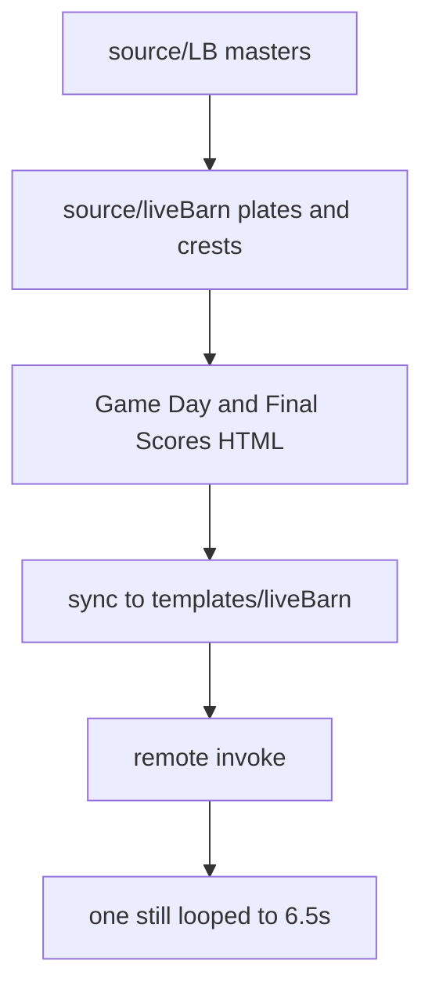

# LiveBarn Overlay Templates - Plan

## Goal Capsule

- **Objective:** A LiveBarn operator can publish a game-day matchup still and a final-score still that match the LiveBarn comps, and can render both through the existing remote renderer.
- **Means:** Two HTML overlays on the ITB still contract, with plates and type taken from the LiveBarn art (KTD1, KTD2).
- **Authority:** The comps and Illustrator files win on look. The ITB templates win on how a still is rendered and published. Assumptions below win only where the request did not choose.
- **Execution:** Smoke-first. Compare a captured still to the comp, then upload and invoke remotely. There is no HTML unit-test suite in this repo.
- **Stop:** Stop if variable text cannot be separated from the proof and the still would draw that text twice. Stop the deploy loop if the remote invoke cannot authenticate, and record the error.
- **Finishes:** Implementation lands the files, the visual check, and one remote invoke per template. Merging stays with the user.

---

## Product Contract

### Summary

Add a LiveBarn game-day overlay and a LiveBarn final-scores overlay. Publish them under the existing `templates/liveBarn/` prefix and render them remotely the same way other templates are rendered.

### Problem Frame

LiveBarn supplied game-day and post-game artwork. The renderer already turns an HTML overlay into a still video for ITB. Those ITB pages use a different layout, different fonts, and different colours, so they cannot stand in for the LiveBarn comps.

### Requirements

**Look**

- R1. Ship two overlays that use the same still-render contract as `source/ITB_GameDay.html` and `source/ITB_FinalScores.html`.
- R2. Background graphics, fonts, and colours come from `source/LB/LB GameDay Matchup.ai` and `source/LB/LB Post Game.ai`. Plates and colour samples are the RGB exports of those files. Fonts are the families named in the files.
- R3. A 1920×1080 still of Game Day matches `source/LB/LB GameDay Matchup.jpg`. A still of Final Scores matches `source/LB/LB Post Game-01.jpg` in regulation and `source/LB/LB Post Game-02.jpg` when overtime is on.

**Publish**

- R4. Publish the new HTML and its web-sized images into the liveBarn folder, using the same bucket and public template prefix the ITB pages already call.
- R5. Run a remote render of each deployed overlay and keep the invoke response.

### Key Flows

- F1. Publish and render
  - **Trigger:** The overlays and plates exist under `source/liveBarn/`.
  - **Steps:** Sync that folder to `templates/liveBarn/`. Invoke the render function with each template key. Open the still.
  - **Outcome:** Each invoke returns an output object, and the still matches the comp named in R3.
  - **Covered by:** R4, R5

### Acceptance Examples

- AE1. Game Day default. **Covers R3.** Given the Game Day defaults, when a still is captured at 1920×1080, then the frame shows GAME DAY, WEDNESDAY, OCTOBER 21, the Knights name on three lines (WILKES-BARRE/, SCRANTON, KNIGHTS), PITTSBURGH over PREDATORS, both crests, and the LiveBarn wordmark on the navy field.
- AE2. Regulation final. **Covers R3.** Given overtime off, when a still is captured, then the grid is 1ST, 2ND, 3RD, and a blue final, with no OT column, and the footer has two note lines.
- AE3. Overtime final. **Covers R3.** Given overtime on, when a still is captured, then an OT column sits between 3RD and the blue final, and the gray cells are narrower than in AE2.

### Scope Boundaries

- The renderer, Lambda handler, and `scripts/upload-template.js` stay as they are.
- ITB HTML is not restyled. Existing uncommitted edits in the ITB files are left untouched.
- Shootout columns, a second overtime column, and summing periods into the final are out. The final is the value in the payload.
- The print-resolution JPEGs and the `.ai` masters in `source/LB/` are not upload targets and are not `images.background`.
- Changing the default all-source sync so it stops using `--delete` is follow-up work. This plan avoids that command.

#### Deferred to Follow-Up Work

- A safer default in `scripts/upload-template.js` that does not delete remote templates missing from `source/`.
- Transparent crest masters, if someone later supplies the linked files `WBS Knights 18UAAA.png` and `Pittsburgh Predators 18UAAA.png`.

### Sources

- `source/ITB_GameDay.html` and `source/ITB_FinalScores.html` — still contract, `TEMPLATE_DIR` ending in `templates/liveBarn/`, `applyGraphic`, `ANIMATION_STILL`.
- `render-transparent-webm.js` — a still captures one frame at half of `animation.hold` and loops it. Duration comes from the injected `getOverlayRenderDuration`. Defining that function in the template skips the injection.
- `overlay-render-runtime.js` — with hold 6 and no tail override, tail is 0.5s, so duration is 6.5s (163 frames at 25 fps) when there is no exit animation.
- `scripts/upload-template.js` — a no-arg run syncs all of `source/` to `templates/` with `--delete`, including JPEG and PNG, and skips `.ai`.
- `scripts/invoke-render.js` — remote invoke from a payload file. ITB examples in `examples/` use a local `html` path and are not the remote path.
- `source/LB/` — Game Day artboard 4800×2700 pt, JPEG 20000×11250. Post Game media box 4818×2718 pt with 9 pt bleed, JPEGs 20075×11325. Embedded faces: Game Day Poppins Bold, Poppins Medium, Roboto Black, Roboto Condensed Bold. Post Game Poppins Bold, Poppins Medium, Poppins SemiBold.

---

## Planning Contract

### Key Technical Decisions

- KTD1. Copy the ITB still contract into both new pages: `window.GRAPHIC`, `applyGraphic`, `ANIMATION_STILL`, `animation.hold` of 6, empty enter/exit hooks, and `TEMPLATE_DIR` pointed at `templates/liveBarn/`. On a `file://` page, resolve plate and crest basenames against the page URL. `TEMPLATE_DIR` applies when the page is http or https. The renderer copies quoted image basenames beside the patched HTML, so a local still can show the U1 files before they are published. Do not define `getOverlayRenderDuration` in the template. Layout, fonts, and colours follow the comps and the Illustrator faces, not the ITB positions or Barlow and Bebas. The request to stay very similar to the ITB files was checked against the comps: matching those pixels would fail R3.
- KTD2. The plate is the field, dots, bars, chevron, and wordmark. HTML draws every string the next game will change, and the crest images. The flattened JPEGs already contain the sample copy, so they are not the plate. Cover those text regions with the local fill before the plate is saved, then draw the strings in HTML. The VS word is part of the chevron art. Do not paint a second VS on top of it.
- KTD3. Publish with a sync of `source/liveBarn/` to `templates/liveBarn/` only. Do not run the no-arg upload script. That command would publish the 20k JPEGs under `templates/LB/` and delete remote objects under `templates/` that are not also under `source/`, including anything already in `templates/liveBarn/` that this repo does not contain.

### Assumptions

These were not chosen in the request. They are the defaults used so the work can proceed.

- The folder name is `liveBarn`, matching the `TEMPLATE_DIR` already in the ITB pages, not a different casing.
- Final Scores is one HTML file. `showOt` defaults to false and selects the Post Game-02 grid when true. A zero in an OT cell does not turn the column on. There is no third template.
- Sample Game Day names are `WILKES-BARRE/\nSCRANTON\nKNIGHTS` and `PITTSBURGH\nPREDATORS`. The name block keeps every newline. The ITB helper keeps only two lines and would join SCRANTON and KNIGHTS, which misses the comp. The template does not split on `/`.
- Footer notes are a bold label and a medium body, four strings for two lines. Copy the words off the Post Game JPEG during implementation. Do not reuse the Eden Prairie / Gentry Academy strings in the ITB file. Empty note strings leave a blank row.
- Period labels (1ST, 2ND, 3RD, OT, FINAL) are fixed in the page. Scores and the final are payload strings. The page does not add the periods.
- Crests are cropped from the proof JPEGs, because the Illustrator files link desktop PNGs that are not in the repo. Slots on the plate are filled with the bar or band colour. A tight crop may show a thin halo. That is accepted until transparent masters exist.
- Colours are sampled from the RGB JPEGs, not from the CMYK Illustrator file. Field navy `#122A46`, names `#060709`, matchup bar `#E8E9EB`, post-game mid band `#D0D1D3`, period cells `#BBBCBE`, period labels and the final column and the vertical FINAL `#307BBF`. Titles, the date, and the numerals are white.
- Faces are the matching Google Fonts families, not the subset fonts embedded in the `.ai` files. Game Day loads Poppins 500 and 700, Roboto 900, and Roboto Condensed 700. Final Scores loads Poppins 500, 600, and 700. Which face sits on which line is set by eye against the comp.
- Output is webm, 1920×1080, 25 fps. Hold stays 6. Expected duration is 6.5s and 163 frames. The captured instant is t = 3s. Do not assert `getTemplateTotalDuration`.
- Compare Game Day to the JPEG scaled to 1920×1080. Compare Final Scores to the JPEG cropped by about 38 px on each edge, then scaled to 1920×1080. That crop removes the white bleed.

### High-Level Technical Design



### Sequencing

U1 produces the plates and crest files. U2 and U3 can proceed after U1, in either order. U4 waits for both HTML files.

---

## Output Structure

```text
source/liveBarn/
  LB_GameDay.html
  LB_FinalScores.html
  gameday-bg.png
  finalscores-bg.png
  knights.png
  predators.png
examples/
  invoke-s3-livebarn-gameday.json
  invoke-s3-livebarn-finalscores.json
  invoke-s3-livebarn-finalscores-ot.json
```

The tree is the expected shape. Per-unit file lists are authoritative.

---

## Implementation Units

### U1. Plates and crest crops

- **Goal:** Put 1920×1080 plates and two crest images in `source/liveBarn/` so later HTML can load them by basename.
- **Requirements:** R2, R3
- **Dependencies:** none
- **Files:** `source/liveBarn/gameday-bg.png`, `source/liveBarn/finalscores-bg.png`, `source/liveBarn/knights.png`, `source/liveBarn/predators.png`
- **Approach:** Downscale the Game Day JPEG to 1920×1080. Crop the Post Game JPEG by the 9 pt bleed, then downscale to 1920×1080. On the Game Day plate, paint out the title, date, and names. Leave the wordmark, dots, bar, and the VS chevron. On the Final Scores plate, paint out the title, date, notes, and the whole score grid (period labels, cell fills, dividers, numerals, and the vertical FINAL). Leave the navy bands, the mid band, dots, and the wordmark. U3 draws both grids on that plate. Fill crest slots with the surrounding bar or band colour and save the crests as their own PNGs. Do not copy the `.ai` files or the 20k JPEGs into this folder.
- **Patterns to follow:** ITB pages reference a background file by basename and resolve it through `TEMPLATE_DIR`.
- **Test scenarios:**
  - Game Day plate is 1920×1080 and has no readable GAME DAY title left in the pixels.
  - Final Scores plate is 1920×1080, with the white bleed gone, and no readable FINAL SCORES title left in the pixels.
  - Both crest files open and show the Knights and Predators marks from the proof.
  - `source/LB/` is unchanged.
- **Verification:** The four images exist at those sizes, and the title areas of both plates are flat fill.

### U2. Game Day overlay

- **Goal:** A Game Day page whose default still matches AE1.
- **Requirements:** R1, R2, R3
- **Dependencies:** U1
- **Files:** `source/liveBarn/LB_GameDay.html`
- **Approach:** Follow KTD1 and KTD2. Fields are title, date, away name, home name, and the two crest basenames. Background is `gameday-bg.png`. Title and date are white on the navy field. Names sit on the bar in the near-black face. The away sample uses the newline from Assumptions. Do not draw a second VS. Hide a crest when its URL is empty.
- **Execution note:** Prove it with a local still against the scaled Game Day JPEG before any upload. Image resolution on that still is KTD1.
- **Patterns to follow:** `source/ITB_GameDay.html` for `applyGraphic`, image resolution, and the still flags.
- **Test scenarios:**
  - Default graphic produces the AE1 frame: GAME DAY, the October 21 date, the Knights name on three lines, Pittsburgh on two lines, both crests, wordmark.
  - An empty away crest hides that image and leaves the slot.
  - A one-word team name stays on one line.
  - A graphic override that changes only the home name leaves the away name and the date at their defaults.
- **Verification:** A local still at 1920×1080 matches the scaled Game Day comp in title, date, both names, and both crests.

### U3. Final Scores overlay

- **Goal:** One Final Scores page that matches AE2 by default and AE3 when overtime is on.
- **Requirements:** R1, R2, R3
- **Dependencies:** U1
- **Files:** `source/liveBarn/LB_FinalScores.html`
- **Approach:** Follow KTD1 and KTD2. `showOt` defaults to false. When it is false the grid is three period columns plus the blue final. When it is true the grid inserts OT and narrows the gray cells. Period labels and the vertical FINAL are fixed copy in the blue from Assumptions. Score cells are white type on the gray and blue fills. Each footer line is a bold label and a medium body. Read the sample note words from the Post Game JPEG. Knights crest is the upper mark, Predators the lower. Background is `finalscores-bg.png` for both grids, because the cells are HTML.
- **Execution note:** Capture two local stills, regulation and overtime, and compare each to the cropped comp. Image resolution on those stills is KTD1.
- **Patterns to follow:** `source/ITB_FinalScores.html` for score fields and notes. The LiveBarn grid replaces that page's positions.
- **Test scenarios:**
  - Default graphic, `showOt` false, matches AE2: three period columns, blue final, vertical FINAL, two footer lines, both crests.
  - `showOt` true with OT scores of 0 matches AE3 and does not drop the OT column.
  - A final of 5 with period cells of 0 stays 5. The page does not sum the periods.
  - An empty note body leaves the label row in place.
  - An empty crest URL hides that image.
- **Verification:** The regulation still matches the cropped Post Game-01 comp, and the overtime still matches the cropped Post Game-02 comp.

### U4. Publish and remote render

- **Goal:** The two pages and their images are public at `templates/liveBarn/`, and each page has a remote render.
- **Requirements:** R4, R5
- **Dependencies:** U2, U3
- **Files:** `examples/invoke-s3-livebarn-gameday.json`, `examples/invoke-s3-livebarn-finalscores.json`, `examples/invoke-s3-livebarn-finalscores-ot.json`
- **Approach:** Follow KTD3. Sync only `source/liveBarn/` to `templates/liveBarn/` on the dev3 bucket in `eu-central-1`. List that prefix before the sync so a later mistake cannot be blamed on an empty folder. Payload keys are `templates/liveBarn/LB_GameDay.html` and `templates/liveBarn/LB_FinalScores.html`. The overtime payload sets `showOt` true. Format, size, and fps follow Assumptions. Output keys live under `renders/`. Leave bucket fields empty so the invoke script fills them.
- **Execution note:** This is a remote smoke. A JSON response is not enough. Open the still and check the title and both crests.
- **Patterns to follow:** `examples/invoke-s3-swpl-defaults.json` for the remote payload shape. `scripts/invoke-render.js` for the invoke.
- **Test scenarios:**
  - After the sync, the Game Day HTML URL and both plate URLs respond.
  - The Game Day invoke returns an output URI, and the still shows the title and both crests.
  - The regulation Final Scores invoke returns an output URI and shows three period columns.
  - The overtime invoke returns an output URI and shows the OT column.
  - A missing image must be caught by looking at the still. Preload treats an image error as success, so a green invoke can still be a blank crest.
- **Verification:** Three invoke responses exist, and each opened still matches the comp for that payload.

---

## Verification Contract

Local stills, before upload:

- `npm run render -- --html source/liveBarn/LB_GameDay.html --format webm --width 1920 --height 1080 --template-width 1920 --template-height 1080 --fps 25 --output livebarn-gameday.webm`
- The same command with `source/liveBarn/LB_FinalScores.html` and output `livebarn-finalscores.webm`.
- A second Final Scores render whose graphic sets `showOt` true.

Remote, after the prefix sync:

- `node scripts/invoke-render.js --payload examples/invoke-s3-livebarn-gameday.json`
- `node scripts/invoke-render.js --payload examples/invoke-s3-livebarn-finalscores.json`
- `node scripts/invoke-render.js --payload examples/invoke-s3-livebarn-finalscores-ot.json`

Pass means the still matches AE1, AE2, or AE3, and the invoke JSON has an output URI. Duration on a hold of 6 is 6.5s. There is no `release:validate` script in this repo.

---

## Definition of Done

- U1 through U4 meet their verification lines.
- `source/LB/` masters are still the only copies of the print JPEGs and the `.ai` files.
- The no-arg upload script was not run.
- Abandoned plate exports and unused HTML are not in the diff.
- ITB files are not restyled by this work.

---

## Risks & Dependencies

- The crest links inside the Illustrator files point at another machine. Crops from the JPEG are the stand-in. A halo around a crest is a known limit, not a failed upload.
- `preloadImages` resolves on error. A remote success can hide a 404 crest or plate. The visual check is the gate.
- Google Fonts must load before `document.fonts.ready`, the same way the ITB pages load Barlow. A render environment with no network will fall back to the next family and miss R2.
- A no-arg `node scripts/upload-template.js` deletes remote templates that are not in `source/`. KTD3 is the mitigation.
