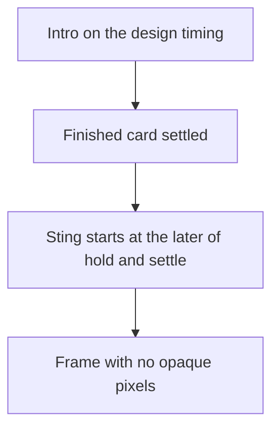
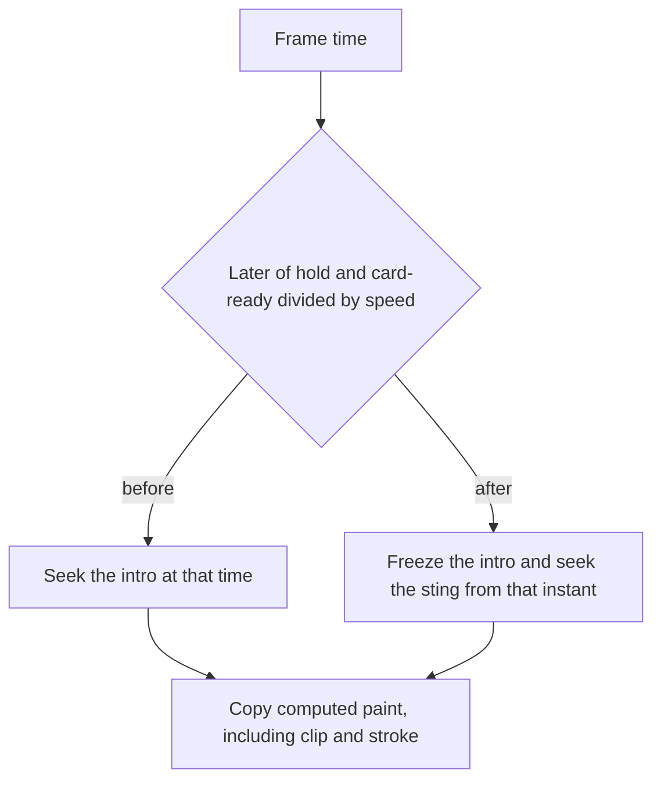

# Sport Matchday Intros - Plan

## Goal Capsule

- **Objective:** An operator can render three sport matchday intros that keep their current look, change the words, colours, speed, and travel, change the tilt on Focus and the tactics board, hold on the finished card, and sting out to a transparent frame.
- **Means:** Each intro seeks its own frames (KTD1).
- **Authority:** The confirmed scope wins on behavior. Each file in `source/sport` wins on look and on the words, colours, and motion it already shows. The other moving overlays win on stopping at a chosen time, holding, and clearing.
- **Execution:** Code. Prove each intro with a local render whose end frame is transparent, then publish it on the existing remote render.
- **Stop:** Stop if a default render cannot keep the drawn pause before the sting without moving the intro beats. Stop the publish step if the remote render cannot authenticate, and record the error.
- **Open blockers:** None.
- **Finishes:** Implementation lands the three intros, the local renders, and one remote render each. Merging stays with the operator.

---

## Product Contract

### Summary

The three matchday intros ship as self-contained moving overlays that keep their look, hold, and sting. Each one seeks its own frames so speed, travel, tilt, and an early hold work, and the shared renderer stays unchanged. Proof is a local transparent render of each intro, then one remote render.

### Problem Frame

The three files in `source/sport` are design-tool previews. A preview control starts each intro, and the frame includes a replay control and a sound control. The moving overlays already in the repo can be stopped on a chosen time, held on the settled card, and cleared off the picture. A render of these previews as they stand keeps the preview controls and a coloured field through the end, so the result cannot be laid over video.

### Key Decisions

- **Hold, then sting.** (session-settled: user-approved — chosen over playing the full timeline with no pause: the finished card stays up, then the designed sting runs.) Governs R6, R7.
- **Home and away names, scores, and crests stay off.** (session-settled: user-approved — chosen over adding them as editable fields: they are not on these intros.) Governs R11.
- **One speed, one travel, and the existing tilts.** (session-settled: user-approved — chosen over a field for every keyframe: speed is one rate, travel is one multiplier, and rotation is only the settled tilt already in Focus and the tactics board.) Governs R12, R13, R14.
- **The hold clock stays in real seconds.** (session-settled: user-approved — chosen over dividing the hold when speed changes: speed scales the intro and sting motion, and the hold time does not shrink.) Governs R12.
- **Preview chrome stays out of the graphic.** (session-settled: user-approved — chosen over keeping the design-tool replay and sound controls: those controls are not part of the overlay.) Governs R15.

### Requirements

**Look**

- R1. Ship three overlays — Matchday Focus, Swiss grid, and tactics board — that keep the motion and layout of `source/sport/MatchDay.html`, `source/sport/MatchDay-SwissGrid.html`, and `source/sport/MatchDay-Tactics.html`, authored at 1920×1080, in Barlow Condensed, Archivo, and Kalam with Permanent Marker respectively.
- R2. An unedited Focus render shows the words MATCHDAY, FOCUS, XI, STARTING, TEAM NEWS, MATCH PREVIEW, and MATCH PREVIEW · TEAM NEWS in primary `#C8102E`, secondary `#FFFFFF`, accent `#F2B705`, and background `#0A0E17`.
- R3. An unedited Swiss-grid render shows the words TEAM, NEWS, STARTING XI, MATCH, DAY, FOCUS, and TEAM NEWS in primary `#1D2BFF`, secondary `#0B0B0B`, accent `#FF4D00`, and background `#ECE8DF`.
- R4. An unedited tactics-board render shows the words TEAM NEWS, Starting XI, MATCHDAY, FOCUS, and Match preview · Team news in primary `#F5D547`, secondary `#F3F1E8`, accent `#E4572E`, and background `#123829`.
- R5. The page behind the graphic is transparent. Opaque colour belongs to the graphic itself.

**Playback**

The intro runs, the finished card holds, the sting plays, and the frame ends empty.

- R6. Each intro plays through the design's sequence until its finished card has settled: Focus on MATCHDAY and FOCUS before the exit wipe, Swiss grid on MATCH, DAY, and FOCUS before the column wipe, and the tactics board on the MATCHDAY and FOCUS tapes before the tape wipe.
- R7. The sting begins at the later of the hold time and the moment the finished card has settled, defaulting to 9.95s for Focus and 10.00s for Swiss grid and the tactics board, and a later hold only lengthens the pause before the same sting.
- R8. A render can show any moment of the intro, the hold, or the sting as the frame at that time, the same way the other moving overlays can be stopped on a chosen time.
- R9. After the sting finishes, the frame has no opaque pixels.

**Edit**

- R10. A render can replace any whole word listed in R2, R3, or R4, counting letter-by-letter spans as one word, and any of that intro's four colours, without moving the layout.
- R11. A request cannot add a word, team name, score, or crest that the intro does not already show. A home team, away team, score, or crest on the request is ignored.
- R12. Playback speed defaults to 1 and scales the intro beats and the sting motion, so speed 2 runs those motions in half the drawn time. The sting still first moves at the hold time in R7, in real seconds.
- R13. Travel defaults to 1 and multiplies the distance of the Focus speed streaks, wipes, and glint, the Swiss-grid opening columns, section slide, and tick, and the tactics-board mark shifts and eraser. Word placement, beat times, and the sting's path off the frame stay as drawn.
- R14. Rotation sets the settled angle of the Focus title to a default of -4°, the tactics board to -1.5°, the MATCHDAY tape to -3°, and the FOCUS tape to 2.5°, each on its own. A rotation value on the Swiss grid does not tilt it.

**Publish**

- R15. Replay controls, sound labels, and audio are absent from every frame.
- R16. After a local render of each intro ends on a transparent frame, each intro can be rendered through the existing remote render the other templates use.

### Actors

- A1. Operator. Supplies the words, colours, hold, speed, travel, and tilt, and asks for a render.
- A2. Render service. Returns a video of the overlay for that request.

### Key Flows

- F1. Render an intro
  - **Trigger:** The operator asks for one of the three intros.
  - **Actors:** A1, A2
  - **Steps:** The intro plays to its finished card, holds, then stings out. The service returns the video.
  - **Outcome:** The video matches that intro's look, and its last frame has no opaque pixels.
  - **Covered by:** R1, R6, R7, R9, R16
- F2. Change the card
  - **Trigger:** The operator changes a word, a colour, the hold, the speed, the travel, or a tilt.
  - **Actors:** A1, A2
  - **Steps:** The same intro renders with that change. Layout and the beats left untouched stay put.
  - **Outcome:** The frame shows the changed value, and the sting still clears the frame.
  - **Covered by:** R7, R10, R12, R13, R14

### Acceptance Examples

- AE1. Focus default. **Covers R2, R6, R9.** Given an unedited Focus intro, when the finished card is shown, then MATCHDAY and FOCUS are on screen in the default colours and the exit wipe has not started. A frame after the sting has no opaque pixels.
- AE2. Swiss-grid default. **Covers R3, R6.** Given an unedited Swiss-grid intro, when the finished card is shown, then MATCH, DAY, and FOCUS are on screen and the column wipe has not started.
- AE3. Tactics default. **Covers R4, R6.** Given an unedited tactics intro, when the finished card is shown, then the MATCHDAY and FOCUS tapes are on screen and the tape wipe has not started.
- AE4. Longer hold. **Covers R7.** Given a hold later than that intro's default, when that hold time is shown, then the finished card is still up and the sting has not started. Just after the hold, the sting is in motion.
- AE5. Early hold. **Covers R7.** Given a hold of 1s, when the finished card has just settled, then the sting starts then, and the intro beats before the card still play on the design's timing.
- AE6. Edited word and colour. **Covers R10.** Given FOCUS replaced with KICKOFF and the Focus primary replaced with `#00FF00`, when the finished card is shown, then KICKOFF is on screen, the primary shapes are `#00FF00`, and MATCHDAY is unchanged.
- AE7. Ignored matchup fields. **Covers R11.** Given a request that also names a home team, when the card is shown, then no home-team line appears.
- AE8. Stop mid-intro. **Covers R8.** Given a time during the opening motion, before the finished card, when that frame is shown, then the intro is part-way through and the sting has not started.
- AE9. No preview chrome. **Covers R15.** Given any frame of any intro, when it is shown, then it has no replay control and no sound label.
- AE10. Double speed. **Covers R12, R7.** Given speed 2 and the default hold on Focus, when 3.5s is shown, the MATCHDAY letters start. When 9.95s is shown, the exit wipe is at its start, and that wipe then finishes in half the time it takes at speed 1.
- AE11. Double travel. **Covers R13, R9.** Given travel 2 on Focus, the speed streaks, wipes, and glint cover twice the drawn distance, MATCHDAY stays in place, and the exit wipe still clears the frame.
- AE12. One tilt at a time. **Covers R14.** Given the tactics board angle set to 10°, the board sits at 10° and the MATCHDAY and FOCUS tapes stay at -3° and 2.5°.
- AE13. Swiss grid has no tilt. **Covers R14.** Given a rotation of 20° on the Swiss grid, the grid is not tilted.

### Scope Boundaries

- Replay controls, sound labels, and generated audio stay out of the graphic, per R15.
- Home and away names, scores, and crests stay out, per R11.
- The clock spin, the dust, the letter slam, and the wipe skew are not edits. A tilt on the Swiss grid stays out, per R14.
- The other templates and the renderer stay as they are.
- The design-tool player bundled with these previews is not part of the rendered overlay.
- The LiveBarn stills are a separate plan and are not restyled.

#### Deferred to Follow-Up Work

- Teaching the shared seeker to copy clip paths, stroke offsets, and letter spacing, and to honor an early hold and a playback speed.

### Dependencies

- These intros use the playback the other moving overlays already have: stop on a chosen time, hold, then exit. Speed, travel, and rotation are edits on that playback, per R12, R13, and R14.
- Accent is each design's tertiary colour, because that choice is on in each preview. The on/off toggle is not a separate edit. Background is the field colour behind the graphic during the intro and the hold.

### Sources

- `source/sport/MatchDay.html` — Focus look, words, colours, and the exit wipe whose first bar moves at 9.95s.
- `source/sport/MatchDay-SwissGrid.html` — Swiss-grid look, words, colours, and the column sting whose first bar moves at 10.00s.
- `source/sport/MatchDay-Tactics.html` — tactics-board look, words, colours, and the tape sting whose first bar moves at 10.00s.
- `source/sport/support.js` — the design-tool player the previews load today. Not a render dependency.
- `source/SWPL_landscape_1.html` — hold is the time from the start until the exit, the init string the renderer merges into, and a transparent page background.
- `docs/plans/2026-10-22-1629-feat-livebarn-overlay-templates-plan.md` — LiveBarn stills. A different job, not a dependency of this one.
- `overlay-render-runtime.js` — the shared seeker bakes opacity, visibility, transform, and filter, and it starts the exit at `animation.hold`. It does not copy clip-path, stroke-dashoffset, or letter-spacing, and it has no playback speed.
- `render-transparent-webm.js` — defining `window.getOverlayRenderDuration` in the page skips injection of that seeker. A local script tag is inlined from beside the HTML file.
- `handler.js` — a remote render downloads the HTML and quoted image files only.
- `source/stinger.html` — a page that keeps its own `prepareFrame` by defining `getOverlayRenderDuration`.

---

## Planning Contract

Product Contract unchanged.

### Key Technical Decisions

- KTD1. Each intro seeks its own frames and does not load the design-tool player. (session-settled: user-approved — chosen over changing the shared seeker: that seeker cannot show these reveals, drawn lines, speed, or an early hold.) The page is self-contained HTML with `GRAPHIC`, `applyGraphic`, `applyAnimationTiming`, and `initGraphic` in the form `source/SWPL_landscape_1.html` already uses, and it defines `getOverlayRenderDuration` so the shared seeker is not injected. `prepareFrame` seeks the CSS animations, then copies opacity, visibility, transform, filter, clip-path, stroke-dashoffset, and letter-spacing onto the elements and clears the animation. Intro delays and durations, and the sting duration, are divided by speed. The sting starts at the later of the hold and the card-ready time divided by speed. Card-ready at speed 1 is 9.4s for Focus, 8.7s for the Swiss grid, and 8.9s for the tactics board. Travel multiplies only the distances named in R13. Rotation sets only the angles named in R14. Ambient motion freezes at its pose at the sting start. The scene stays opaque until the sting has covered it, then the sting leaves, and 0.5s of empty frames follow. A speed of 0 or less is treated as 1.

### High-Level Technical Design

A frame is either still in the intro or already in the sting. Speed changes how fast those motions play. It does not move the hold clock.

### Assumptions

- Fonts load from Google stylesheets in `head`, the same way `source/SWPL_landscape_1.html` loads its faces. A machine that cannot reach that host falls back and the layout can move.
- The card-ready times in KTD1 are the end of the title beats, not the end of the slow drift or camera moves.

### Sequencing

U1 lands the seek on Focus. U2 and U3 repeat that seek on the other two intros. U4 publishes only after the three local renders end on an empty frame.

### Risks

- The seek is copied into three pages, because a remote render does not download a sibling script. A later edit can update one page and miss the others.
- Archivo is a variable face. If the width axis does not apply, the Swiss-grid lines reflow.

---

## Implementation Units

### U1. Focus overlay

- **Goal:** Matchday Focus renders as a moving overlay with its own frame seek.
- **Requirements:** R1, R2, R5, R6, R7, R8, R9, R10, R12, R13, R14, R15. KTD1.
- **Dependencies:** None.
- **Files:** `source/sport/MatchDay.html`, `examples/invoke-s3-sport-focus.json`
- **Approach:**
  - Replace the design-tool page with a transparent `.overlay` that no longer loads `source/sport/support.js`.
  - Keep the Focus words, colours, and motion from R2 and R1. Title tilt defaults to -4°. Load Barlow Condensed from a stylesheet link in `head`.
  - Travel covers the speed streaks, the wipes, and the glint. The exit bars keep their drawn path.
  - Card-ready is 9.4s and the exit bars last 1.3s at speed 1, per KTD1.
  - Write `examples/invoke-s3-sport-focus.json` in the shape of `examples/invoke-s3-swpl-defaults.json`, with `htmlS3Key` `templates/sport/MatchDay.html` and `outputS3Key` `renders/sport-focus.webm`. Put speed 2 on its `graphic` for the remote speed check.
- **Patterns to follow:** `source/SWPL_landscape_1.html` for the init string and the transparent page. `source/stinger.html` for keeping `prepareFrame` by defining `getOverlayRenderDuration`.
- **Execution note:** Render this page locally before starting U2. The seek shape the other two copy has to be visible here first.
- **Test scenarios:**
  - Covers AE1. Unedited Focus at 9.4s shows MATCHDAY and FOCUS in `#C8102E`, `#FFFFFF`, `#F2B705`, and `#0A0E17`, and the exit wipe has not started. A frame after the wipe has no opaque pixels.
  - Covers AE5. Hold 1s. The intro beats still play on their drawn timing, and the exit wipe starts at 9.4s.
  - Covers AE6. `text` replaces FOCUS with KICKOFF and primary with `#00FF00`. The card shows KICKOFF, primary shapes are `#00FF00`, and MATCHDAY is unchanged.
  - Covers AE7. A graphic payload that also sets a home team shows no home-team line.
  - Covers AE8. A frame at 2s is part-way through the opening and the exit wipe has not started.
  - Covers AE9. No frame shows a replay control or a sound label.
  - Covers AE10. Speed 2 and the default hold. At 3.5s the MATCHDAY letters start. At 9.95s the exit wipe is at its start and then finishes in 0.65s.
  - Covers AE11. Travel 2. The streaks, wipes, and glint cover twice the drawn distance, MATCHDAY stays in place, and the exit wipe still clears the frame.
  - Title tilt 0°. The title sits level.
  - Speed 0. The page plays at speed 1.
- **Verification:** `npm run render -- --html source/sport/MatchDay.html --format webm --width 1920 --height 1080 --fps 25 --output output/sport-focus.webm` ends on an empty frame. A second render with `--graphic` pointing at a partial override for KICKOFF, speed 2, and travel 2 shows that word, the 3.5s letter start, and the doubled streaks.

### U2. Swiss-grid overlay

- **Goal:** The Swiss-grid intro uses the Focus seek with its own words, colours, and motion.
- **Requirements:** R1, R3, R5, R6, R7, R9, R10, R12, R13, R14, R15. KTD1.
- **Dependencies:** U1
- **Files:** `source/sport/MatchDay-SwissGrid.html`, `examples/invoke-s3-sport-swiss.json`
- **Approach:**
  - Repeat the U1 page shape. Load Archivo from a stylesheet link in `head`. Words and colours are R3. There is no tilt control.
  - Travel covers the opening columns, the section slide, and the tick. The exit columns keep their drawn path.
  - Card-ready is 8.7s and the exit columns last 1.2s at speed 1, per KTD1.
  - Write `examples/invoke-s3-sport-swiss.json` with `htmlS3Key` `templates/sport/MatchDay-SwissGrid.html` and `outputS3Key` `renders/sport-swiss.webm`.
- **Patterns to follow:** The Focus page from U1.
- **Test scenarios:**
  - Covers AE2. Unedited Swiss grid at 8.7s shows MATCH, DAY, and FOCUS, and the column wipe has not started.
  - Covers AE13. A rotation of 20° does not tilt the grid.
  - Covers AE4. Hold 12s. At 12s the finished card is still up and the column wipe has not started. Just after 12s the wipe is in motion.
  - Speed 2 and the default hold. The column wipe first moves at 10.00s, and its motion takes 0.6s.
  - A frame after the wipe has no opaque pixels, and no frame shows a replay control.
- **Verification:** `npm run render -- --html source/sport/MatchDay-SwissGrid.html --format webm --width 1920 --height 1080 --fps 25 --output output/sport-swiss.webm` ends on an empty frame.

### U3. Tactics-board overlay

- **Goal:** The tactics-board intro uses the Focus seek, with independent tilts for the board and the two tapes.
- **Requirements:** R1, R4, R5, R6, R7, R9, R10, R12, R13, R14, R15. KTD1.
- **Dependencies:** U1
- **Files:** `source/sport/MatchDay-Tactics.html`, `examples/invoke-s3-sport-tactics.json`
- **Approach:**
  - Repeat the U1 page shape. Load Kalam and Permanent Marker from a stylesheet link in `head`. Words and colours are R4. Board tilt defaults to -1.5°, the MATCHDAY tape to -3°, and the FOCUS tape to 2.5°.
  - Travel covers the mark shifts and the eraser. The exit tapes keep their drawn path.
  - Card-ready is 8.9s and the exit tapes last 1.2s at speed 1, per KTD1.
  - Write `examples/invoke-s3-sport-tactics.json` with `htmlS3Key` `templates/sport/MatchDay-Tactics.html` and `outputS3Key` `renders/sport-tactics.webm`.
  - Float and dust keep playing through the intro and freeze at the pose they hold when the sting starts.
- **Patterns to follow:** The Focus page from U1.
- **Test scenarios:**
  - Covers AE3. Unedited tactics board at 8.9s shows the MATCHDAY and FOCUS tapes, and the tape wipe has not started.
  - Covers AE12. Board angle 10°. The board sits at 10° and the tapes stay at -3° and 2.5°.
  - Speed 2 and the default hold. The tape wipe first moves at 10.00s.
  - A frame after the wipe has no opaque pixels. Dust is still on its path at 4s and does not jump when the wipe starts.
- **Verification:** `npm run render -- --html source/sport/MatchDay-Tactics.html --format webm --width 1920 --height 1080 --fps 25 --output output/sport-tactics.webm` ends on an empty frame.

### U4. Remote render

- **Goal:** Each intro can be rendered through the existing remote render after its local render ends on an empty frame.
- **Requirements:** R16. KTD1.
- **Dependencies:** U1, U2, U3
- **Files:** `examples/invoke-s3-sport-focus.json`, `examples/invoke-s3-sport-swiss.json`, `examples/invoke-s3-sport-tactics.json`
- **Approach:**
  - Upload the three HTML pages with `npm run upload-template`. The sync maps `source/sport/*.html` to `templates/sport/*.html` and does not upload a sibling script.
  - Invoke each page with `npm run invoke -- --payload` and the matching example. Those payloads use `htmlS3Key`, which is what makes the deployed function download the uploaded page.
- **Patterns to follow:** `examples/invoke-s3-swpl-defaults.json` and `scripts/invoke-render.js`.
- **Execution note:** This is a smoke check. Run it only after the three local webms end on an empty frame. If the remote call cannot authenticate, record the error and stop.
- **Test scenarios:**
  - Covers F1. Each invoke returns a video object, and the video's last moment has no opaque pixels.
  - An invoke with speed 2 on Focus still starts the exit wipe at 9.95s.
- **Verification:** `npm run upload-template`, then `npm run invoke -- --payload examples/invoke-s3-sport-focus.json`, and the same for the Swiss and tactics payloads. A failed authentication is recorded and is not treated as a render failure.

---

## Verification Contract

This repo has no HTML unit-test script. The proof is a local webm of each intro, then one remote invoke.

- Focus local: `npm run render -- --html source/sport/MatchDay.html --format webm --width 1920 --height 1080 --fps 25 --output output/sport-focus.webm`
- Swiss local: `npm run render -- --html source/sport/MatchDay-SwissGrid.html --format webm --width 1920 --height 1080 --fps 25 --output output/sport-swiss.webm`
- Tactics local: `npm run render -- --html source/sport/MatchDay-Tactics.html --format webm --width 1920 --height 1080 --fps 25 --output output/sport-tactics.webm`
- Remote: `npm run upload-template`, then `npm run invoke -- --payload examples/invoke-s3-sport-focus.json` and the Swiss and tactics payloads.
- `render-transparent-webm.js`, `overlay-render-runtime.js`, `handler.js`, and the other templates are unchanged.

---

## Definition of Done

- An operator can render all three intros with the words, colours, hold, speed, travel, and tilts named in the Product Contract, and each sting ends on a frame with no opaque pixels.
- U1, U2, and U3 each have a local webm whose last frame is empty, and U4 has one remote video per intro.
- The diff does not edit the shared renderer or the other templates.
- Pages do not reference `source/sport/support.js`.
- Abandoned seek experiments are not left in the diff.
